<a name="top"></a>
<!-- ══════════════════════════════════════════════════════════════════ -->
<!--  GUNARA OS — README MASTERPIECE · International Standard          -->
<!--  Languages: 🇮🇩 Bahasa Indonesia + 🇬🇧 English · Version: v3.0      -->
<!-- ══════════════════════════════════════════════════════════════════ -->

<div align="center">

# ⚡ G U N A R A ⋅ O S ⚡

### 🇮🇩 Sistem Operasi Pribadi & Bisnis — Sekelas Notion, Ditempa Khusus untuk Gunara Corp
### 🇬🇧 The Personal & Business Operating System — Notion-Grade, Custom-Forged for One

**🇮🇩 [Bahasa Indonesia](#bahasa-indonesia) &nbsp;·&nbsp; 🇬🇧 [English](#english) &nbsp;·&nbsp; [⬇ Galeri](#id-galeri) &nbsp;·&nbsp; [🚀 Memulai](#id-memulai)**

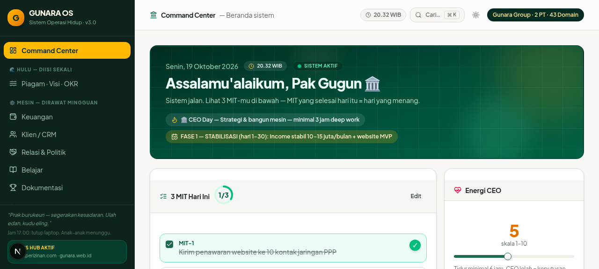

<br/>

[](#id-versi)
[](https://nextjs.org)
[](https://react.dev)
[](https://typescriptlang.org)
[](https://tailwindcss.com)
[](https://prisma.io)
[](https://motion.dev)
[](#id-standar)
[](#id-keamanan)
[](#id-keamanan)
[](#id-standar)
[]()
[](#id-lisensi)

</div>

<br/>

---

<a name="bahasa-indonesia"></a>
## 🇮🇩 BAHASA INDONESIA

> *"Air jernih mengalir dari hulu. Bangun hulunya sekali, rawat mesinnya tiap minggu, jalankan hilirnya tiap hari — hasilnya adalah konsekuensi, bukan kebetulan."*
> — **Piagam GUNARA OS**

<div align="right"><a href="#top">⬆ kembali ke atas</a></div>

<a name="id-tentang"></a>
### ✨ 1. Tentang GUNARA OS

**GUNARA OS** bukan sekadar aplikasi catatan. Ia adalah **sistem operasi lengkap untuk hidup dan bisnis** — dibangun sekelas Notion, tetapi diarsitekuri di sekeliling *satu orang*: Gugun Gunara, pemilik Gunara Corp. Setiap piksel, setiap tabel database, dan setiap animasi dirancang untuk menjawab satu pertanyaan: *"apa yang harus saya kerjakan hari ini supaya 10 tahun ke depan saya menang?"* Dokumen-dokumen strategi pribadi (14 file dari `github-docs/`) tidak dibiarkan menganggur sebagai teks — semuanya dikompilasi menjadi perangkat lunak yang hidup dan berinteraksi.

Aplikasi ini menggabungkan tiga dunia yang biasanya terpisah: **OS pribadi** (filosofi hidup, disiplin harian, keuangan keluarga), **kantor konsultan perizinan** (CRM, tracker pengurusan izin ISO, katalog 46 layanan), dan **arsenal strategis** (43 domain portfolio, 15 AI agents dengan prompt role-activation siap pakai, roadmap 90 hari). Ketiganya berteistur dalam satu SPA ringkas dengan satu Command Center sebagai kokpit.

Tiga keunggulan yang membuatnya berbeda:

| 🏛️ | 🛡️ | ⚡ |
|---|---|---|
| **Arsitektur Hulu → Mesin → Hilir** | **Keamanan kelas enterprise** | **Pengalaman premium** |
| Filosofi air: isi hulu sekali, mesin dirawat mingguan, hilir dijalankan harian | scrypt, AES-256-GCM, secrets di-strip otomatis dari API | Animasi sinematik penuh, ⌘K, dark mode, jam WIB live |

<div align="right"><a href="#top">⬆</a></div>

<a name="id-filosofi"></a>
### 🌊 2. Filosofi Arsitektur: Hulu · Mesin · Hilir

Sistem ini meniru aliran sungai. **Hulu** adalah mata air — piagam diri, visi 10 tahun, OKR, dan kurikulum yang *diisi sekali* lalu menjadi sumber segala keputusan. **Mesin** adalah lima generator nilai — keuangan, CRM, relasi & politik, belajar, dokumentasi — yang *dirawat setiap minggu* agar terus menghasilkan. **Hilir** adalah aliran harian — ritual pagi, review mingguan, backlog, dan log keputusan — yang *dijalankan setiap hari* tanpa perlu berpikir ulang. Bisnis Hub berdiri di muara: tempat semua nilai mengalir menjadi pendapatan nyata.

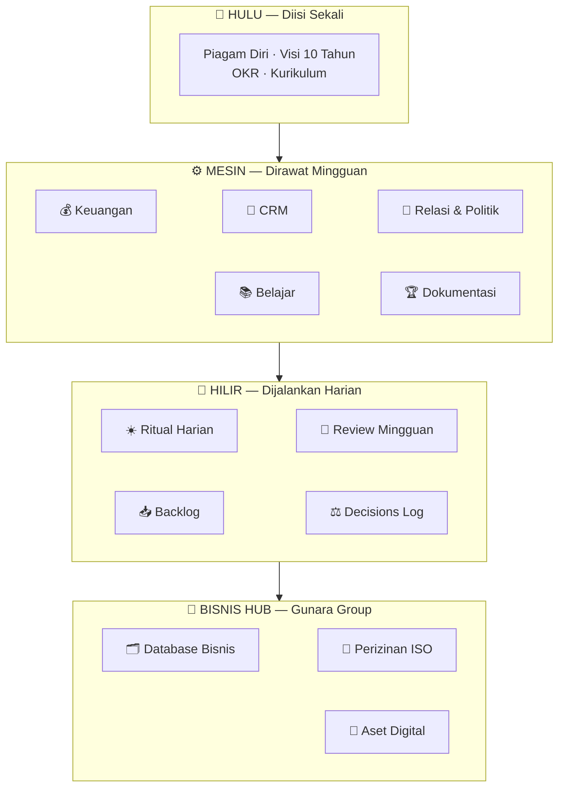

<div align="right"><a href="#top">⬆</a></div>

<a name="id-peta"></a>
### 🧭 3. Peta Lengkap 19 Section

Satu route (`/`), sembilan belas section state-based, semuanya dapat dilompati lewat **Command Palette (⌘K / Ctrl+K)**.

| # | Section | Grup | Fungsi |
|---|---------|------|--------|
| 0 | 🏠 **Command Center** | Beranda | Kokpit harian: sapaan, jam WIB live, 3 MIT, energi, statistik, fase aktif |
| 1 | 🌊 **Piagam · Visi · OKR** | HULU | Mata air segalanya — diisi sekali |
| 2 | 💰 **Keuangan** | MESIN | Hutang + cicilan otomatis, piutang, arus kas, rekening anak |
| 3 | 👥 **Klien / CRM** | MESIN | Master klien + pipeline follow-up dengan flag telat otomatis |
| 4 | 🤝 **Relasi & Politik** | MESIN | Ledger kepercayaan & aktivitas strategis |
| 5 | 📚 **Belajar** | MESIN | Jurnal pembelajaran — mesin ganda |
| 6 | 🏆 **Dokumentasi** | MESIN | Win Log + Studi Kasus |
| 7 | ☀️ **Ritual Harian** | HILIR | 3 MIT pagi + refleksi malam + riwayat |
| 8 | 📅 **Review Mingguan** | HILIR | 30 menit tiap akhir pekan |
| 9 | 📥 **Backlog** | HILIR | Penjara ide — agar fokus tak bocor |
| 10 | ⚖️ **Decisions Log** | HILIR | Sejarah keputusan & alasannya |
| 11 | 🌐 **43 Domain** | ARSENAL | Portfolio domain + misi per domain |
| 12 | 🤖 **15 AI Agents** | ARSENAL | Role activation prompt siap copy-paste |
| 13 | 🛡️ **Sistem** | ARSENAL | 10 aturan mutlak, pola mingguan, protokol hari buruk, master prompt, stack |
| 14 | 🎯 **Roadmap 90 Hari** | ARSENAL | Grand Build Fase 0–5 dengan gate |
| 15 | 💼 **Database Bisnis** | BISNIS HUB | Pelanggan 360° (25 field) + Perusahaan & legalitas |
| 16 | 📜 **Perizinan** | BISNIS HUB | Kanban 5 tahap ISO, katalog 46 layanan, Pencari Izin |
| 17 | 🔐 **Aset Digital** | BISNIS HUB | Sosmed, Brankas kredensial terenkripsi, Pengguna & role |
| 18 | 📚 **Tutorial Lengkap** | PANDUAN | 18 panduan langkah-demi-langkah seluruh fitur |

<div align="right"><a href="#top">⬆</a></div>

<a name="id-fitur"></a>
### 💎 4. Fitur Utama

#### 🏠 Command Center
- **Jam live WIB + sapaan dinamis** — pagi/siang/sore/malam mengikuti waktu nyata, dirender client-safe tanpa hydration error.
- **3 MIT (Most Important Tasks)** — tulis, centang dengan animasi spring, otomatis sinkron dengan Ritual Harian.
- **Slider energi 1–10** — angka pop beranimasi; nilai ≤ 4 memicu peringatan protokol hari buruk.
- **4 stat card CountUp** — sisa hutang, piutang, klien aktif, follow-up telat; semua beranimasi dari nilai sebelumnya.
- **Strip Bisnis Hub** — ringkasan pelanggan, izin berjalan, dan nilai pipeline (Rp) yang bisa diklik menuju tracker.

#### 🏃 Mesin Disiplin
- **Keuangan 4-in-1** — hutang dengan dialog *Cicil* (sisa terhitung otomatis + toast), piutang, arus kas, rekening anak.
- **CRM cerdas** — counter pipeline, flag **TELAT** merah otomatis untuk follow-up melewati jatuh tempo.
- **Ritual Harian** — MIT pagi + refleksi malam dalam satu log per tanggal (upsert otomatis).

#### 🛡️ Arsenal Strategis
- **15 AI Agents** — kartu per gelombang, dialog *Role Activation* berisi prompt lengkap, tombol copy → "Tersalin!".
- **43 Domain Portfolio** — tabel editable + grid tergrup per tier (INTI / GATEWAY / FUTURE / PARKED).
- **Roadmap Grand Build** — Fase 0–5 dengan gerbang kelulusan, kalender 90 hari, target finansial.

#### 💼 Bisnis Hub — Perangkat Konsultan Perizinan
- **Database Pelanggan 360°** — 25 field metadata: KTP, NPWP, alamat, sumber lead, preferensi komunikasi, status, catatan.
- **Database Perusahaan** — NIB, NPWP, SK AHU, KBLI, modal, status grup (Gunara Consultant ⇄ PusatPerizinan.com).
- **Kanban Perizinan 5 Tahap (ISO 9001:2015)** — Konsultasi → Dokumen → Pengajuan → Terbit → Serah Terima; status pelanggan ikut berganti otomatis saat kartu pindah tahap.
- **Pencari Izin (Rules Engine)** — pilih 10 sektor × skala usaha × 9 flag kondisi → daftar izin terprioritas WAJIB → OPSIONAL + estimasi biaya + **1 klik masuk tracker**.
- **Katalog 46 Layanan** — harga, durasi, instansi penanggung jawab; searchable real-time.
- **Brankas Kredensial (11 kategori)** — EMAIL_GOOGLE, OSS, PAJAK, BANK, dsb.; semua terenkripsi AES-256-GCM dengan *Vault Health Check* bergaya OWASP.
- **Aset Sosial Media** — platform, username, metrik follower, cadance konten, status akses.
- **Pengguna & Role** — OWNER/ADMIN/STAFF dengan password scrypt + indikator kekuatan sandi NIST.

<div align="right"><a href="#top">⬆</a></div>

<a name="id-galeri"></a>
### 🖼️ 5. Galeri

| Command Center | Kanban Perizinan ISO |
|---|---|
|  | 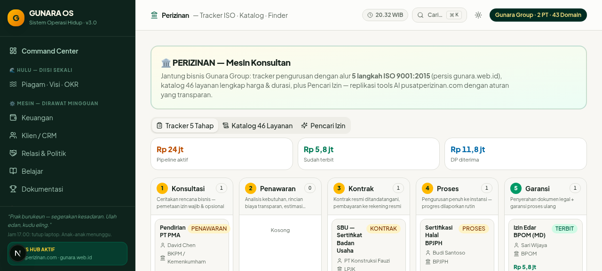 |
| **Pencari Izin — Rules Engine** | **Hasil Rekomendasi + Estimasi Biaya** |
| 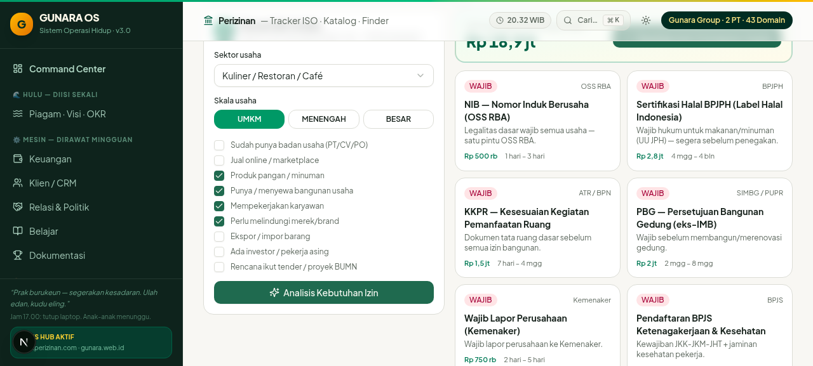 | 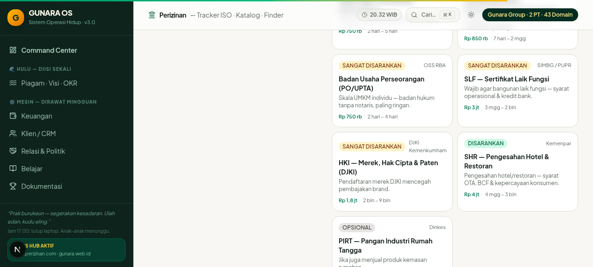 |
| **Database Bisnis** | **Brankas Terenkripsi + Reveal** |
| 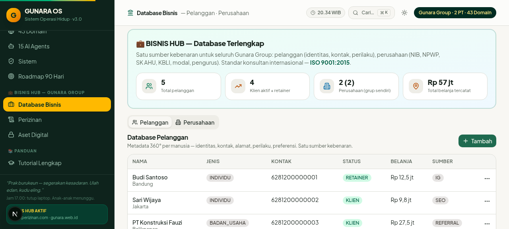 | 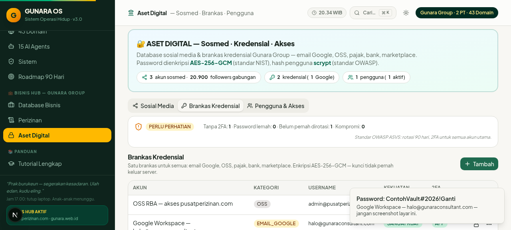 |
| **Mode Gelap** | **Mobile Responsive 390px** |
| 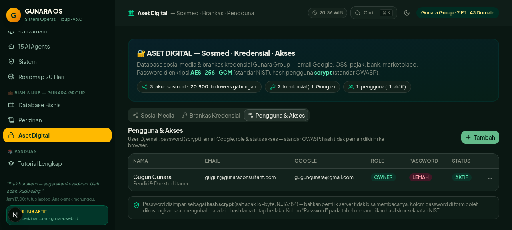 | 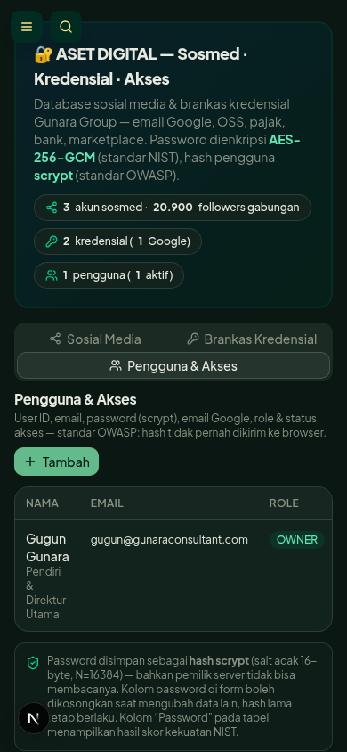 |

<div align="right"><a href="#top">⬆</a></div>

<a name="id-database"></a>
### 🗄️ 6. Database — Metadata Terlengkap: 26 Model

Satu file `prisma/schema.prisma` mengelola **26 model** dalam **SQLite** (siap migrasi ke PostgreSQL untuk multi-device). Semua resource dilayani lewat **API generik** `/api/data/[resource]` yang dikonfigurasi dari satu peta — menambah resource baru tidak butuh endpoint baru.

| Domain | Model | Peran |
|---|---|---|
| ⚙️ Inti Sistem | `Setting` | Piagam, visi 10 tahun, OKR, kurikulum, master prompt, protokol hari buruk, fase aktif |
| 💰 Keuangan | `Debt` `DebtPayment` `Receivable` `Cashflow` `ChildSaving` | Hutang + riwayat cicilan, piutang, arus kas, tabungan anak |
| 👥 CRM | `Client` `FollowUp` | Master klien, pipeline, follow-up dengan flag telat otomatis |
| 🤝 Relasi | `Relation` `PoliticalActivity` | Ledger kepercayaan, aktivitas politik strategis |
| 📚 Pertumbuhan | `LearningJournal` `WinLog` `CaseStudy` | Jurnal belajar (mesin ganda), kemenangan, studi kasus |
| 🏃 Disiplin | `DailyLog` `WeeklyReview` `BacklogItem` `DecisionLog` | Ritual harian, review mingguan, penjara ide, sejarah keputusan |
| 🛡️ Arsenal | `Domain` `Agent` | 43 domain portfolio, 15 AI agents + prompt role-activation |
| 💼 Bisnis Hub | `AppUser` `Customer` `Company` `SocialAccount` `VaultEntry` `PermitApplication` `ServiceCatalog` | Pengguna & role, pelanggan 25 field, perusahaan & legalitas, sosmed, brankas 11 kategori, tracker izin 5 tahap, katalog 46 layanan |

<details>
<summary>🔍 <b>Buka: sorotan field kunci Bisnis Hub (klik)</b></summary>

| Model | Sorotan Field |
|---|---|
| `AppUser` | email, password (scrypt + salt), role (OWNER/ADMIN/STAFF), 2FA flag, failedAttempts, lastLogin |
| `Customer` | nama, KTP, NPWP, telepon/WA, email, alamat lengkap, sumber lead, preferensi komunikasi, status, nilai bisnis, catatan — **25 field 360°** |
| `Company` | nama legal, brand, NIB, NPWP, SK AHU, KBLI, modal dasar, alamat, status grup, relasi kepemilikan |
| `SocialAccount` | platform, username, url, password (AES-256-GCM), email terkait, follower, cadance konten, status akses |
| `VaultEntry` | 11 kategori (EMAIL_GOOGLE, OSS, PAJAK, BANK, HOSTING, DOMAIN, dll.), username, password + PIN + backup codes terenkripsi, catatan, health flags |
| `PermitApplication` | klien, layanan, **tahap 1–5 ISO**, harga deal, biaya instansi, DP, sisa, tanggal & PIC per tahap, status otomatis |
| `ServiceCatalog` | nama, kategori, instansi, harga, durasi, syarat — **46 layanan ter-seed** dari audit gunara.web.id |
</details>

<div align="right"><a href="#top">⬆</a></div>

<a name="id-keamanan"></a>
### 🔐 7. Keamanan — Zero-Compromise Vault

Keamanan dirancang dengan prinsip *assume breach*: meski database bocor, kredensial tetap terlindungi.

| Lapisan | Mekanisme | Standar Acuan |
|---|---|---|
| Password pengguna | **scrypt** + salt unik, verifikasi *timing-safe* | NIST SP 800-63B |
| Kredensial brankas | **AES-256-GCM** terenkripsi *at-rest* (password, PIN, backup codes) | OWASP |
| Eksposur API | Semua field rahasia **di-strip otomatis** dari setiap response list/detail | Privacy by Design |
| Reveal on-demand | Endpoint eksklusif `?reveal=password\|pin\|backupCodes` per item | Least Privilege |
| Kekuatan sandi | `passwordStrength()` — panjang, variasi karakter, pola umum | NIST SP 800-63B |
| Vault Health | Pemindaian kesehatan: 2FA belum aktif, sandi duplikat/lemah, cadance cadangan | OWASP AMM |
| Manajemen kunci | `GUNARA_VAULT_KEY` via environment — tak pernah masuk kode | 12-Factor Config |

<details>
<summary>🔐 <b>Buka: alur enkripsi (diagram)</b></summary>

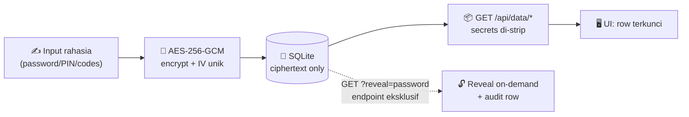
</details>

<div align="right"><a href="#top">⬆</a></div>

<a name="id-standar"></a>
### 🌍 8. Standar Internasional yang Diterapkan

| Standar | Penerapan Konkret di Kode |
|---|---|
| **ISO 9001:2015** | Alur perizinan 5 tahap dengan status otomatis antar-tahap — proses terukur, terdokumentasi, ter-audit |
| **NIST SP 800-63B** | Kebijakan sandi + hashing scrypt timing-safe |
| **OWASP Top 10 / AMM** | Enkripsi at-rest, strip secrets, Vault Health |
| **WCAG 2.2** | `focus-visible` ring, dukungan `prefers-reduced-motion` (CSS + Framer), `aria-label` penuh, `sr-only` dialog descriptions |
| **12-Factor App** | Konfigurasi via environment, satu codebase, proses stateless |
| **SemVer** | vMAJOR.MINOR.PATCH + changelog terstruktur (lih. Riwayat Versi) |
| **Clean Architecture** | UI *config-driven* dari satu peta (`gunara.tsx`), API generik, pustaka animasi terpusat (`motion.tsx`) |
| **Type-Safe End-to-End** | TypeScript 5 + Prisma Client yang digenerate dari schema |

Doktrin rekayasa: ** hydration-safe by design** (semua data waktu dirender client-only via `useMounted()`/`useNow()`), **reduced-motion first**, dan **lint 0 error · 0 warning** sebagai gerbang merge.

<div align="right"><a href="#top">⬆</a></div>

<a name="id-memulai"></a>
### 🚀 9. Memulai

**Prasyarat:** [Bun](https://bun.sh) ≥ 1.1 *(atau Node.js ≥ 20)* · Git

```bash
# 1️⃣ Kloning & masuk
git clone https://github.com/prabudanling/doc-gunaracorp.git gunara-os
cd gunara-os

# 2️⃣ Instal dependensi
bun install            # atau: npm install

# 3️⃣ Siapkan environment — buat file .env:
#    DATABASE_URL="file:./db/custom.db"
#    GUNARA_VAULT_KEY="ganti-dengan-kunci-rahasia-minimal-32-karakter"

# 4️⃣ Bentuk struktur database dari 26 model
bun run db:push

# 5️⃣ Isi data awal (idempoten — aman dijalankan ulang)
bun scripts/seed.ts         # OS: piagam, visi, OKR, 43 domain, 15 agents, dst.
bun scripts/seed-bisnis.ts  # Bisnis Hub: 46 layanan, 2 perusahaan, OWNER, contoh data

# 6️⃣ Nyalakan
bun run dev
# → buka http://localhost:3000 — selamat datang di kokpitmu 🚀
```

> 💡 **Produksi:** `bun run build` lalu `bun run start` (standalone server). Wajib set `GUNARA_VAULT_KEY` yang kuat dan acak — kunci ini mengenkripsi seluruh brankas kredensial.

<div align="right"><a href="#top">⬆</a></div>

<a name="id-skrip"></a>
### 📜 10. Skrip & Perintah

| Perintah | Fungsi |
|---|---|
| `bun run dev` | Server pengembangan (Turbopack) + log ke `dev.log` |
| `bun run build` | Build produksi (standalone + statik) |
| `bun run start` | Jalankan server produksi |
| `bun run lint` | ESLint — saat ini **0 error · 0 warning** |
| `bun run db:push` | Sinkronisasi schema Prisma → SQLite |
| `bun run db:generate` | Generate Prisma Client |
| `bun run db:migrate` / `db:reset` | Migrasi formal & reset database |
| `bun scripts/seed.ts` | Seed OS (settings, 43 domain, 15 agents, win logs) |
| `bun scripts/seed-bisnis.ts` | Seed Bisnis Hub (46 layanan, perusahaan, OWNER, brankas, sosmed, pelanggan, pengurusan) |

<div align="right"><a href="#top">⬆</a></div>

<a name="id-pintasan"></a>
### ⌨️ 11. Pintasan Keyboard

| Pintasan | Aksi |
|---|---|
| <kbd>⌘</kbd> / <kbd>Ctrl</kbd> + <kbd>K</kbd> | Buka **Command Palette** — lompat ke 19 section |
| <kbd>↑</kbd> <kbd>↓</kbd> | Navigasi hasil filter |
| <kbd>↵</kbd> | Lompat ke section terpilih |
| <kbd>Esc</kbd> | Tutup palette / drawer / dialog |
| 🌗 **Tombol tema** | Terang ⇄ Gelap (tersimpan otomatis, default ikuti sistem) |

<div align="right"><a href="#top">⬆</a></div>

<a name="id-struktur"></a>
### 🏗️ 12. Struktur Proyek

<details>
<summary>📂 <b>Buka pohon proyek (klik)</b></summary>

```text
src/
├── app/
│   ├── page.tsx                    # SPA tunggal — AppShell
│   ├── layout.tsx                  # Root layout + ThemeProvider
│   ├── globals.css                 # Tema emerald-imperium + keyframes animasi
│   └── api/data/
│       ├── route.ts                # Health check
│       └── [resource]/
│           ├── route.ts            # GET list + POST (enkripsi otomatis)
│           └── [id]/route.ts       # PATCH, DELETE, GET ?reveal=
├── components/
│   ├── app/
│   │   ├── app-shell.tsx           # Kerangka: sidebar, header, transisi antar-section
│   │   ├── dashboard.tsx           # Command Center
│   │   ├── hulu.tsx                # Piagam · Visi · OKR
│   │   ├── finance.tsx crm.tsx mesin-lain.tsx   # Modul MESIN
│   │   ├── hilir.tsx               # Ritual · Review · Backlog · Keputusan
│   │   ├── arsenal.tsx             # Domain · Agents · Sistem · Roadmap
│   │   ├── bisnis.tsx              # Database Pelanggan & Perusahaan
│   │   ├── perizinan.tsx           # Kanban ISO · Katalog · Pencari Izin
│   │   ├── aset-digital.tsx        # Sosmed · Brankas · Pengguna
│   │   ├── guide.tsx               # Tutorial 18 panduan
│   │   ├── command-palette.tsx     # ⌘K (cmdk)
│   │   ├── motion.tsx              # Pustaka animasi bersama (FadeUp, CountUp, dst.)
│   │   ├── record-table.tsx        # Tabel + dialog form generik
│   │   └── use-records.ts nav.ts   # Hooks & peta navigasi
│   └── ui/                         # shadcn/ui — 40+ komponen Radix
├── lib/
│   ├── gunara.tsx                  # Konfigurasi 20+ resource (field, form, tone)
│   ├── crypto.ts                   # scrypt · AES-256-GCM · passwordStrength
│   ├── license-finder.ts           # Rules engine 10 sektor × 9 flag
│   ├── service-catalog.ts          # 46 layanan
│   └── db.ts                       # Prisma singleton
└── prisma/schema.prisma            # 26 model — metadata terlengkap
scripts/
├── seed.ts                         # Seed OS
├── seed-bisnis.ts                  # Seed Bisnis Hub
└── restart-dev.sh                  # Clean-restart server dev
```
</details>

<div align="right"><a href="#top">⬆</a></div>

<a name="id-versi"></a>
### 📖 13. Riwayat Versi

| Versi | Kodename | Sorotan |
|---|---|---|
| **v1.0** | *Foundation* | OS inti: arsitektur Hulu/Mesin/Hilir, 19 model Prisma, SPA 15 section, CRUD generik, seed dari 14 dokumen strategi |
| **v2.0** | *Motion* | Animasi penuh (FadeUp, Stagger, CountUp, FloatingOrbs), ⌘K Command Palette, dark mode persist, jam live WIB, skeleton shimmer, perbaikan hydration tanggal |
| **v2.1** | *Hardening* | Kebal kelas error hydration Radix/React 19.2, lint 0/0, aksesibilitas dialog lengkap, SheetDescription sr-only |
| **v3.0** | *Bisnis Hub* | **Metadata terlengkap**: +7 model (AppUser, Customer, Company, SocialAccount, VaultEntry, PermitApplication, ServiceCatalog), audit dua situs perusahaan, Kanban ISO 5 tahap, Pencari Izin, brankas AES-256-GCM, tutorial 18 panduan |

<div align="right"><a href="#top">⬆</a></div>

<a name="id-roadmap"></a>
### 🗺️ 14. Roadmap

- [x] **v1.0** — OS pribadi lengkap
- [x] **v2.0** — Animasi penuh + fitur standar internasional
- [x] **v2.1** — Hardening hydration & aksesibilitas
- [x] **v3.0** — Bisnis Hub + metadata terlengkap + tools konsultan
- [ ] **v4.0 — *Konvergensi*** *(dirancang)*
  - 🔑 Login Google OAuth (next-auth sudah disiapkan di dependensi)
  - 🤖 AI Copilot in-app (z-ai-web-dev-sdk): ringkasan mingguan otomatis, drafting follow-up klien
  - 📲 PWA + mode offline, push reminder ritual harian
  - ☁️ Sinkronisasi multi-device — migrasi SQLite → PostgreSQL
- [ ] **v5.0 — *Skala Gunara Group***
  - 📱 Aplikasi mobile (React Native) berbagi API
  - 🏢 Multi-tenant untuk tim — role granular per divisi
  - 📊 BI dashboard: tren pipeline, omzet per instansi, konversi lead
  - 💬 Integrasi WhatsApp API untuk follow-up otomatis klien

<div align="right"><a href="#top">⬆</a></div>

<a name="id-faq"></a>
### ❓ 15. FAQ

<details>
<summary><b>Kenapa hanya satu route (<code>/</code>)?</b></summary>

Sesuai whitepaper & prinsip sandbox: satu SPA state-based lebih cepat, bebas reload, dan seluruh 19 section dilompati via Command Palette — pengalaman ala aplikasi desktop di browser.
</details>

<details>
<summary><b>Apakah data saya aman di SQLite lokal?</b></summary>

Ya untuk skenario personal: password pengguna di-hash scrypt, seluruh kredensial brankas terenkripsi AES-256-GCM, dan API tidak pernah mengembalikan field rahasia. Untuk multi-device, migrasi ke PostgreSQL + RLS sudah masuk roadmap v4.0.
</details>

<details>
<summary><b>Kenapa jam/tanggal baru muncul setelah halaman terbuka?</b></summary>

Itu fitur, bukan bug — *hydration-safe by design*. Data waktu memang hanya dirender di klien agar server (UTC) tidak pernah bertabrakan dengan klien (WIB). Nol hydration error terverifikasi.
</details>

<details>
<summary><b>Bagaimana menambah jenis data baru?</b></summary>

Tambahkan model di `schema.prisma` → `bun run db:push` → daftarkan di `MODELS` (API) + konfigurasi resource di `gunara.tsx` → section muncul. Tidak perlu endpoint baru; API-nya generik.
</details>

<div align="right"><a href="#top">⬆</a></div>

<a name="id-lisensi"></a>
### 📜 16. Lisensi & Kontak

**© 2026 Gunara Corp — All rights reserved.** Perangkat lunak pribadi yang ditempa khusus untuk Gugun Gunara; tidak untuk didistribusikan tanpa izin tertulis.

| Kanal | Alamat |
|---|---|
| 🏢 **PusatPerizinan.com** | [pusatperizinan.com](https://pusatperizinan.com) — konsultan perizinan usaha #1, 1.247+ klien |
| 🌐 **Gunara Web** | [gunara.web.id](https://gunara.web.id) — 46 kategori layanan, 38 provinsi, proses ISO 9001:2015 |
| 📄 **Dokumentasi Strategi** | [github.com/prabudanling/doc-gunaracorp](https://github.com/prabudanling/doc-gunaracorp) |

<br/>

---

<a name="english"></a>
## 🇬🇧 ENGLISH

> *"Clear water flows from the upstream. Build your upstream once, service your engines weekly, run your downstream daily — results become consequences, not accidents."*
> — **The GUNARA OS Charter**

<div align="right"><a href="#top">⬆ back to top</a></div>

<a name="en-about"></a>
### ✨ 1. About GUNARA OS

**GUNARA OS** is not just another notes app. It is a **complete operating system for life and business** — built to Notion-grade standards, but architected around *one person*: Gugun Gunara, owner of Gunara Corp. Every pixel, every database table, and every animation is designed to answer a single question: *"what must I do today so that, ten years from now, I win?"* The private strategy documents (14 files in `github-docs/`) were never left idle as text — they were compiled into living, interactive software.

The app fuses three worlds that usually live apart: a **personal OS** (life philosophy, daily discipline, family finances), a **licensing consultancy back office** (CRM, ISO-stage permit tracker, 46-service catalog), and a **strategic arsenal** (43-domain portfolio, 15 AI agents with ready-to-use role-activation prompts, a 90-day roadmap). All three coexist in one lean SPA with a single Command Center as the cockpit.

Three advantages that set it apart:

| 🏛️ | 🛡️ | ⚡ |
|---|---|---|
| **Upstream → Engine → Downstream architecture** | **Enterprise-grade security** | **Premium experience** |
| The water philosophy: fill upstream once, service engines weekly, run downstream daily | scrypt, AES-256-GCM, secrets auto-stripped from every API response | Full cinematic animation, ⌘K palette, dark mode, live WIB clock |

<div align="right"><a href="#top">⬆</a></div>

<a name="en-philosophy"></a>
### 🌊 2. Architecture Philosophy: Upstream · Engine · Downstream

The system mirrors a river. The **Upstream (Hulu)** is the spring — personal charter, 10-year vision, OKRs, and curriculum — *filled once*, then serving as the source of every decision. The **Engines (Mesin)** are five value generators — finance, CRM, relations & politics, learning, documentation — *serviced weekly* so they keep producing. The **Downstream (Hilir)** is the daily flow — morning ritual, weekly review, backlog, decision log — *executed daily* without rethinking. The Business Hub sits at the river mouth, where all value flows into real revenue.

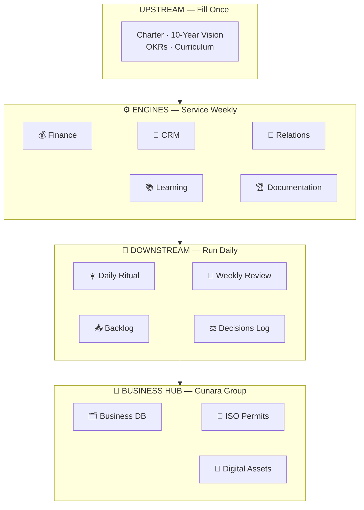

<div align="right"><a href="#top">⬆</a></div>

<a name="en-map"></a>
### 🧭 3. The Complete Map: 19 Sections

One route (`/`), nineteen state-based sections — every one of them reachable through the **Command Palette (⌘K / Ctrl+K)**.

| # | Section | Group | Purpose |
|---|---------|-------|---------|
| 0 | 🏠 **Command Center** | Home | Daily cockpit: greeting, live WIB clock, 3 MITs, energy, stats, active phase |
| 1 | 🌊 **Charter · Vision · OKR** | UPSTREAM | The source of everything — filled once |
| 2 | 💰 **Finance** | ENGINES | Debts + auto installments, receivables, cashflow, child savings |
| 3 | 👥 **Clients / CRM** | ENGINES | Client master + follow-up pipeline with auto LATE flag |
| 4 | 🤝 **Relations & Politics** | ENGINES | Trust ledger & strategic activities |
| 5 | 📚 **Learning** | ENGINES | Learning journal — the double engine |
| 6 | 🏆 **Documentation** | ENGINES | Win Log + Case Studies |
| 7 | ☀️ **Daily Ritual** | DOWNSTREAM | 3 morning MITs + evening reflection + history |
| 8 | 📅 **Weekly Review** | DOWNSTREAM | 30 minutes every weekend |
| 9 | 📥 **Backlog** | DOWNSTREAM | The idea prison — so focus never leaks |
| 10 | ⚖️ **Decisions Log** | DOWNSTREAM | Decision history & rationale |
| 11 | 🌐 **43 Domains** | ARSENAL | Domain portfolio + per-domain mission |
| 12 | 🤖 **15 AI Agents** | ARSENAL | Role-activation prompts, copy-ready |
| 13 | 🛡️ **System** | ARSENAL | 10 absolute rules, weekly pattern, bad-day protocol, master prompt, stack |
| 14 | 🎯 **90-Day Roadmap** | ARSENAL | Grand Build Phases 0–5 with gates |
| 15 | 💼 **Business Database** | BUSINESS HUB | 360° customers (25 fields) + companies & legal entities |
| 16 | 📜 **Permits** | BUSINESS HUB | 5-stage ISO kanban, 46-service catalog, License Finder |
| 17 | 🔐 **Digital Assets** | BUSINESS HUB | Social media, encrypted credential vault, users & roles |
| 18 | 📚 **Full Tutorial** | GUIDE | 18 step-by-step guides covering every feature |

<div align="right"><a href="#top">⬆</a></div>

<a name="en-features"></a>
### 💎 4. Key Features

#### 🏠 Command Center
- **Live WIB clock + dynamic greeting** — morning/afternoon/evening/night follows real time, rendered client-safe with zero hydration errors.
- **3 MITs (Most Important Tasks)** — write, check with a spring animation, auto-synced with the Daily Ritual.
- **Energy slider 1–10** — animated number pop; values ≤ 4 trigger the bad-day protocol warning.
- **4 CountUp stat cards** — outstanding debt, receivables, active clients, late follow-ups; all animate from their previous values.
- **Business Hub strip** — customer, running permit, and pipeline value (Rp) summary that jumps straight to the tracker.

#### 🏃 Discipline Engines
- **Finance 4-in-1** — debts with an *Install* dialog (remaining balance computed instantly + toast), receivables, cashflow, child savings.
- **Smart CRM** — pipeline counters and an automatic red **LATE** flag for overdue follow-ups.
- **Daily Ritual** — morning MITs + evening reflection in one log per date (auto upsert).

#### 🛡️ Strategic Arsenal
- **15 AI Agents** — one card per wave, a *Role Activation* dialog with the full prompt, copy button → "Copied!".
- **43-Domain Portfolio** — editable table + tier-grouped grid (INTI / GATEWAY / FUTURE / PARKED).
- **Grand Build Roadmap** — Phases 0–5 with graduation gates, 90-day calendar, financial targets.

#### 💼 Business Hub — The Licensing Consultant's Toolkit
- **360° Customer Database** — 25 metadata fields: ID card (KTP), tax ID (NPWP), address, lead source, communication preference, status, notes.
- **Company Database** — NIB, NPWP, AHU deeds, KBLI codes, capital, group status (Gunara Consultant ⇄ PusatPerizinan.com).
- **5-Stage Permit Kanban (ISO 9001:2015)** — Consultation → Documents → Filing → Issued → Handover; customer status auto-transitions as cards move.
- **License Finder (Rules Engine)** — pick 10 sectors × business scale × 9 condition flags → prioritized permit list (MANDATORY → OPTIONAL) + cost estimates + **one click into the tracker**.
- **46-Service Catalog** — price, duration, responsible agency; real-time search.
- **Credential Vault (11 categories)** — GOOGLE_EMAIL, OSS, TAX, BANK, etc.; all encrypted with AES-256-GCM and guarded by an OWASP-style *Vault Health Check*.
- **Social Media Assets** — platform, handle, follower metrics, content cadence, access status.
- **Users & Roles** — OWNER/ADMIN/STAFF with scrypt passwords + NIST password-strength indicator.

<div align="right"><a href="#top">⬆</a></div>

<a name="en-gallery"></a>
### 🖼️ 5. Gallery

| Command Center | ISO Permit Kanban |
|---|---|
|  |  |
| **License Finder — Rules Engine** | **Recommendations + Cost Estimates** |
|  |  |
| **Business Database** | **Encrypted Vault + Reveal** |
|  |  |
| **Dark Mode** | **Mobile Responsive 390px** |
|  |  |

<div align="right"><a href="#top">⬆</a></div>

<a name="en-database"></a>
### 🗄️ 6. Database — The Most Complete Metadata: 26 Models

A single `prisma/schema.prisma` governs **26 models** on **SQLite** (PostgreSQL-ready for multi-device). Every resource is served through a **generic API** at `/api/data/[resource]` driven by one configuration map — adding a new resource requires zero new endpoints.

| Domain | Models | Role |
|---|---|---|
| ⚙️ System Core | `Setting` | Charter, 10-year vision, OKRs, curriculum, master prompt, bad-day protocol, active phase |
| 💰 Finance | `Debt` `DebtPayment` `Receivable` `Cashflow` `ChildSaving` | Debts + installment history, receivables, cashflow, child savings |
| 👥 CRM | `Client` `FollowUp` | Client master, pipeline, follow-ups with auto LATE flag |
| 🤝 Relations | `Relation` `PoliticalActivity` | Trust ledger, strategic political activity |
| 📚 Growth | `LearningJournal` `WinLog` `CaseStudy` | Learning journal (double engine), wins, case studies |
| 🏃 Discipline | `DailyLog` `WeeklyReview` `BacklogItem` `DecisionLog` | Daily ritual, weekly review, idea prison, decision history |
| 🛡️ Arsenal | `Domain` `Agent` | 43-domain portfolio, 15 AI agents + role-activation prompts |
| 💼 Business Hub | `AppUser` `Customer` `Company` `SocialAccount` `VaultEntry` `PermitApplication` `ServiceCatalog` | Users & roles, 25-field customers, companies & legalities, social accounts, 11-category vault, 5-stage permit tracker, 46-service catalog |

<details>
<summary>🔍 <b>Open: Business Hub key-field highlights (click)</b></summary>

| Model | Field Highlights |
|---|---|
| `AppUser` | email, password (scrypt + salt), role (OWNER/ADMIN/STAFF), 2FA flag, failedAttempts, lastLogin |
| `Customer` | name, KTP, NPWP, phone/WA, email, full address, lead source, communication preference, status, business value, notes — **25 fields, 360°** |
| `Company` | legal name, brand, NIB, NPWP, AHU deed, KBLI, authorized capital, address, group status, ownership relation |
| `SocialAccount` | platform, username, url, password (AES-256-GCM), linked email, followers, content cadence, access status |
| `VaultEntry` | 11 categories (GOOGLE_EMAIL, OSS, TAX, BANK, HOSTING, DOMAIN, etc.), username, encrypted password + PIN + backup codes, notes, health flags |
| `PermitApplication` | client, service, **ISO stages 1–5**, deal price, agency fees, down payment, balance, per-stage dates & PIC, auto status |
| `ServiceCatalog` | name, category, agency, price, duration, requirements — **46 services seeded** from the gunara.web.id audit |
</details>

<div align="right"><a href="#top">⬆</a></div>

<a name="en-security"></a>
### 🔐 7. Security — The Zero-Compromise Vault

Security follows an *assume breach* principle: even if the database leaks, credentials stay protected.

| Layer | Mechanism | Reference Standard |
|---|---|---|
| User passwords | **scrypt** + unique salt, timing-safe verification | NIST SP 800-63B |
| Vault credentials | **AES-256-GCM** encrypted at-rest (password, PIN, backup codes) | OWASP |
| API exposure | All secret fields **auto-stripped** from every list/detail response | Privacy by Design |
| On-demand reveal | Exclusive per-item endpoint `?reveal=password\|pin\|backupCodes` | Least Privilege |
| Password strength | `passwordStrength()` — length, character variety, common patterns | NIST SP 800-63B |
| Vault Health | Health scan: missing 2FA, duplicate/weak passwords, backup cadence | OWASP AMM |
| Key management | `GUNARA_VAULT_KEY` via environment — never in code | 12-Factor Config |

<details>
<summary>🔐 <b>Open: encryption flow (diagram)</b></summary>

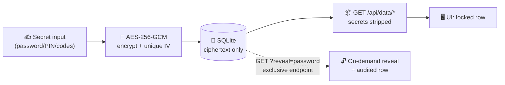
</details>

<div align="right"><a href="#top">⬆</a></div>

<a name="en-standards"></a>
### 🌍 8. International Standards Applied

| Standard | Concrete Implementation in Code |
|---|---|
| **ISO 9001:2015** | 5-stage permit workflow with automatic stage-to-stage status — measurable, documented, auditable processes |
| **NIST SP 800-63B** | Password policy + timing-safe scrypt hashing |
| **OWASP Top 10 / AMM** | Encryption at-rest, secret stripping, Vault Health |
| **WCAG 2.2** | `focus-visible` rings, `prefers-reduced-motion` support (CSS + Framer), full `aria-label` coverage, `sr-only` dialog descriptions |
| **12-Factor App** | Environment-based config, one codebase, stateless processes |
| **SemVer** | vMAJOR.MINOR.PATCH + structured changelog (see Version History) |
| **Clean Architecture** | Config-driven UI from a single map (`gunara.tsx`), generic API, centralized motion library (`motion.tsx`) |
| **End-to-End Type Safety** | TypeScript 5 + Prisma Client generated from schema |

Engineering doctrine: **hydration-safe by design** (all time-based data renders client-only via `useMounted()`/`useNow()`), **reduced-motion first**, and **0 errors · 0 warnings lint** as the merge gate.

<div align="right"><a href="#top">⬆</a></div>

<a name="en-getting-started"></a>
### 🚀 9. Getting Started

**Prerequisites:** [Bun](https://bun.sh) ≥ 1.1 *(or Node.js ≥ 20)* · Git

```bash
# 1️⃣ Clone & enter
git clone https://github.com/prabudanling/doc-gunaracorp.git gunara-os
cd gunara-os

# 2️⃣ Install dependencies
bun install            # or: npm install

# 3️⃣ Set up the environment — create a .env file:
#    DATABASE_URL="file:./db/custom.db"
#    GUNARA_VAULT_KEY="replace-with-a-random-secret-of-32+-chars"

# 4️⃣ Shape the database from 26 models
bun run db:push

# 5️⃣ Seed initial data (idempotent — safe to re-run)
bun scripts/seed.ts         # OS: charter, vision, OKRs, 43 domains, 15 agents, etc.
bun scripts/seed-bisnis.ts  # Business Hub: 46 services, 2 companies, OWNER, sample data

# 6️⃣ Launch
bun run dev
# → open http://localhost:3000 — welcome to your cockpit 🚀
```

> 💡 **Production:** `bun run build` then `bun run start` (standalone server). Always set a strong, random `GUNARA_VAULT_KEY` — this key encrypts the entire credential vault.

<div align="right"><a href="#top">⬆</a></div>

<a name="en-scripts"></a>
### 📜 10. Scripts & Commands

| Command | Purpose |
|---|---|
| `bun run dev` | Development server (Turbopack) + logs to `dev.log` |
| `bun run build` | Production build (standalone + static) |
| `bun run start` | Run the production server |
| `bun run lint` | ESLint — currently **0 errors · 0 warnings** |
| `bun run db:push` | Sync Prisma schema → SQLite |
| `bun run db:generate` | Generate Prisma Client |
| `bun run db:migrate` / `db:reset` | Formal migrations & database reset |
| `bun scripts/seed.ts` | Seed OS (settings, 43 domains, 15 agents, win logs) |
| `bun scripts/seed-bisnis.ts` | Seed Business Hub (46 services, companies, OWNER, vault, socials, customers, permits) |

<div align="right"><a href="#top">⬆</a></div>

<a name="en-shortcuts"></a>
### ⌨️ 11. Keyboard Shortcuts

| Shortcut | Action |
|---|---|
| <kbd>⌘</kbd> / <kbd>Ctrl</kbd> + <kbd>K</kbd> | Open the **Command Palette** — jump to 19 sections |
| <kbd>↑</kbd> <kbd>↓</kbd> | Navigate filtered results |
| <kbd>↵</kbd> | Jump to the selected section |
| <kbd>Esc</kbd> | Close palette / drawer / dialog |
| 🌗 **Theme button** | Light ⇄ Dark (persisted, defaults to system) |

<div align="right"><a href="#top">⬆</a></div>

<a name="en-structure"></a>
### 🏗️ 12. Project Structure

<details>
<summary>📂 <b>Open the project tree (click)</b></summary>

```text
src/
├── app/
│   ├── page.tsx                    # Single-route SPA — AppShell
│   ├── layout.tsx                  # Root layout + ThemeProvider
│   ├── globals.css                 # Emerald-imperium theme + animation keyframes
│   └── api/data/
│       ├── route.ts                # Health check
│       └── [resource]/
│           ├── route.ts            # GET list + POST (auto-encryption)
│           └── [id]/route.ts       # PATCH, DELETE, GET ?reveal=
├── components/
│   ├── app/
│   │   ├── app-shell.tsx           # Frame: sidebar, header, section transitions
│   │   ├── dashboard.tsx           # Command Center
│   │   ├── hulu.tsx                # Charter · Vision · OKR
│   │   ├── finance.tsx crm.tsx mesin-lain.tsx   # ENGINE modules
│   │   ├── hilir.tsx               # Ritual · Review · Backlog · Decisions
│   │   ├── arsenal.tsx             # Domains · Agents · System · Roadmap
│   │   ├── bisnis.tsx              # Customer & Company database
│   │   ├── perizinan.tsx           # ISO Kanban · Catalog · License Finder
│   │   ├── aset-digital.tsx        # Socials · Vault · Users
│   │   ├── guide.tsx               # 18 tutorials
│   │   ├── command-palette.tsx     # ⌘K (cmdk)
│   │   ├── motion.tsx              # Shared motion library (FadeUp, CountUp, etc.)
│   │   ├── record-table.tsx        # Generic table + form dialog
│   │   └── use-records.ts nav.ts   # Hooks & navigation map
│   └── ui/                         # shadcn/ui — 40+ Radix components
├── lib/
│   ├── gunara.tsx                  # Config for 20+ resources (fields, forms, tones)
│   ├── crypto.ts                   # scrypt · AES-256-GCM · passwordStrength
│   ├── license-finder.ts           # Rules engine: 10 sectors × 9 flags
│   ├── service-catalog.ts          # 46 services
│   └── db.ts                       # Prisma singleton
└── prisma/schema.prisma            # 26 models — the most complete metadata
scripts/
├── seed.ts                         # OS seed
├── seed-bisnis.ts                  # Business Hub seed
└── restart-dev.sh                  # Clean-restart the dev server
```
</details>

<div align="right"><a href="#top">⬆</a></div>

<a name="en-versions"></a>
### 📖 13. Version History

| Version | Codename | Highlights |
|---|---|---|
| **v1.0** | *Foundation* | Core OS: Upstream/Engine/Downstream architecture, 19 Prisma models, 15-section SPA, generic CRUD, seeded from 14 strategy documents |
| **v2.0** | *Motion* | Full animation (FadeUp, Stagger, CountUp, FloatingOrbs), ⌘K Command Palette, persisted dark mode, live WIB clock, skeleton shimmer, date hydration fix |
| **v2.1** | *Hardening* | Immune to the Radix/React 19.2 hydration error class, 0/0 lint, complete dialog accessibility, sr-only SheetDescription |
| **v3.0** | *Business Hub* | **The most complete metadata**: +7 models (AppUser, Customer, Company, SocialAccount, VaultEntry, PermitApplication, ServiceCatalog), two-company site audit, 5-stage ISO kanban, License Finder, AES-256-GCM vault, 18 in-app tutorials |

<div align="right"><a href="#top">⬆</a></div>

<a name="en-roadmap"></a>
### 🗺️ 14. Roadmap

- [x] **v1.0** — Complete personal OS
- [x] **v2.0** — Full animation + international-standard features
- [x] **v2.1** — Hydration & accessibility hardening
- [x] **v3.0** — Business Hub + most-complete metadata + consultant tools
- [ ] **v4.0 — *Convergence*** *(designed)*
  - 🔑 Google OAuth login (next-auth already prepared in dependencies)
  - 🤖 In-app AI Copilot (z-ai-web-dev-sdk): automatic weekly summaries, client follow-up drafting
  - 📲 PWA + offline mode, push reminders for the daily ritual
  - ☁️ Multi-device sync — SQLite → PostgreSQL migration
- [ ] **v5.0 — *Gunara Group Scale***
  - 📱 Mobile app (React Native) sharing the same API
  - 🏢 Multi-tenant for teams — granular per-division roles
  - 📊 BI dashboard: pipeline trends, revenue per agency, lead conversion
  - 💬 WhatsApp API integration for automated client follow-ups

<div align="right"><a href="#top">⬆</a></div>

<a name="en-faq"></a>
### ❓ 15. FAQ

<details>
<summary><b>Why is there only one route (<code>/</code>)?</b></summary>

By design, per the whitepaper & sandbox principle: a single state-based SPA is faster, reload-free, and all 19 sections are reachable through the Command Palette — a desktop-app experience inside the browser.
</details>

<details>
<summary><b>Is my data safe in local SQLite?</b></summary>

Yes for the personal scenario: user passwords are scrypt-hashed, all vault credentials are AES-256-GCM encrypted, and the API never returns secret fields. For multi-device, the PostgreSQL + RLS migration is on the v4.0 roadmap.
</details>

<details>
<summary><b>Why does the clock/date only appear after the page opens?</b></summary>

That is a feature, not a bug — *hydration-safe by design*. Time-based data intentionally renders on the client only, so the server (UTC) can never disagree with the client (WIB). Zero hydration errors, verified.
</details>

<details>
<summary><b>How do I add a new type of data?</b></summary>

Add a model to `schema.prisma` → `bun run db:push` → register it in `MODELS` (API) + the resource config in `gunara.tsx` → the section appears. No new endpoints needed; the API is generic.
</details>

<div align="right"><a href="#top">⬆</a></div>

<a name="en-license"></a>
### 📜 16. License & Contact

**© 2026 Gunara Corp — All rights reserved.** Private software custom-forged for Gugun Gunara; not for distribution without written permission.

| Channel | Address |
|---|---|
| 🏢 **PusatPerizinan.com** | [pusatperizinan.com](https://pusatperizinan.com) — #1 business licensing consultancy, 1,247+ clients |
| 🌐 **Gunara Web** | [gunara.web.id](https://gunara.web.id) — 46 service categories, 38 provinces, ISO 9001:2015 process |
| 📄 **Strategy Documentation** | [github.com/prabudanling/doc-gunaracorp](https://github.com/prabudanling/doc-gunaracorp) |

<br/>

<br/>

---

<div align="center">

## ⚡ GUNARA OS

**🇮🇩 Karena hidup dan bisnismu layak memiliki sistem operasi.**
**🇬🇧 Because your life and business deserve an operating system.**

| | |
|---|---|
| 🧠 **Engineered doctrine** | Master Polymath · Sage Universal · Ultimate Problem Solver |
| 🏛️ **Council** | 46 cross-domain expert councils, distilled into software |
| 🛠️ **Stack** | Next.js 16 · React 19 · TypeScript 5 · Tailwind 4 · Prisma 6 · Framer Motion 12 |
| 🌏 **Origin** | Dibangun dengan ❤️ + ☕ di Indonesia — Built with love & coffee in Indonesia |

<br/>

<a href="#bahasa-indonesia">🇮🇩 Baca versi Bahasa Indonesia</a> &nbsp;·&nbsp; <a href="#english">🇬🇧 Read the English version</a> &nbsp;·&nbsp; <a href="#top">⬆ Naik ke puncak / Back to top</a>

<br/>

**© 2026 Gunara Corp™ · v3.0 "Bisnis Hub" · All rights reserved**

</div>

